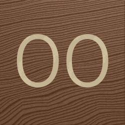

<div align="center">



# r00ms

**Психологический сурвайвал-хоррор от первого лица на движке Godot 4, вдохновлённый классическим *Rooms* и *Rooms & Doors*.**

*Тысяча процедурных комнат. Затухающий свет. Сущности, охотящиеся по звуку и шагам.*

[](https://godotengine.org)
[]()
[](https://github.com/AfonasGa/r00ms/releases/tag/stable)
[](https://partner.steamgames.com)

</div>

---

## 📥 Скачать / Downloads (Stable 1.0.0)

Выберите сборку под вашу платформу:

| Платформа | Ссылка на скачивание | Установка |
| :--- | :--- | :--- |
| 💻 **Windows** | [**`stable1.0.0.rar`**](https://github.com/AfonasGa/r00ms/releases/download/stable/stable1.0.0.rar) | Распаковать архив и запустить `r00ms.exe` |
| 📱 **Android** | [**`r00ms.apk`**](https://github.com/AfonasGa/r00ms/releases/download/stable/r00ms.apk) | Установить APK на телефон (разрешить установку из неизвестных источников) |
| 🍏 **iOS** | [**`r00ms-iOS-unsigned.ipa`**](https://github.com/AfonasGa/r00ms/releases/download/stable/r00ms-iOS-unsigned.ipa) | Установка через [Sideloadly](https://sideloadly.io), [AltStore](https://altstore.io), SideStore или [TrollStore](https://github.com/opa334/TrollStore) |

> [!TIP]
> Версия для **iOS** скомпилирована в `unsigned` формате — для её работы не требуется платный аккаунт Apple Developer, достаточно бесплатного личного Apple ID в Sideloadly / AltStore.

---

## 👁️ Сущности (Entities)

* **A-60 (The Multi-Monster)** — проносится по комнатам с оглушающим низким ревом и искажением экрана. Единственный шанс выжить — успеть залезть в шкаф или спрятаться под стол до его появления.
* **A-60′ (The Multi-Monster Prime)** — тихая, но коварная вариация, появляющаяся после A-49. Не издает громкого звука приближения — выдаёт себя яростным мерцанием фонарика. Способен атаковать до 4 раз подряд; требует выходить и повторно заходить в шкаф, сбивая тайминг Тьмы.
* **A-120** — барабанящие шаги и жуткая улыбка в дверном проёме. Двигается скачками вперед и назад по коридорам, требуя выдержки перед выходом из укрытия.
* **The Darkness (Тьма)** — карающая сущность укрытий. Если пересидеть в шкафу слишком долго — Тьма атакует.
* **Архитектор** — терминальная сущность на экране смерти с моноширинным ретро-интерфейсом. Анализирует причины гибели, дает советы и **помнит** ваши предыдущие попытки и пройденные дистанции.

---

## 🔦 Особенности игры

* **Синхронизированная процедурная генерация** — комнаты от A-000 до A-1000 создаются на общем генераторе. У всех игроков в мультиплеере структура комнат идентична.
* **Динамические двери** — плавная анимация открывания от себя (0.25 сек). При высоком запасе стамины двери распахиваются настежь с разбега.
* **Укрытия с коллизией занятости** — шкафы и столы поддерживают только одного игрока (занятое укрытие блокирует вход для других). Анимация рук при входе и выходе.
* **Фонарик** — честный менеджмент батареек: 2 минуты активной работы, предупреждающий тусклый режим с мерцанием за 30 секунд до отключения, перезарядка на `[R]` при наличии 2 батарей.
* **Трясосвет (Динамо-фонарь)** — не требует батареек, заряжается удерживанием `[ПКМ]` плавной анимацией взмахов руки. Можно крутить прямо в шкафу (замедляет шаг в 2 раза).
* **Кооператив (Steam P2P)** — совместное прохождение, синхронизированные атаки монстров, модельки Roblox Noob с анимациями и режим наблюдателя (Spectator) после гибели.

---

## 🎮 Управление

| Действие | ПК (Клавиатура + Мышь) | Смартфоны (Экранные кнопки) |
| :--- | :--- | :--- |
| **Передвижение** | `[W]`, `[A]`, `[S]`, `[D]` | Сенсорный джойстик слева |
| **Спринт / Бег** | `[Shift]` | Кнопка спринта |
| **Присесть** | `[Ctrl]` / `[C]` | Кнопка приседа |
| **Открыть дверь / Взаимодействие** | `[ЛКМ]` | Тап по экрану / кнопка действия |
| **Вкл/Выкл фонарик** | `[ПКМ]` | Кнопка фонаря |
| **Зарядка трясосвета** | Удержание `[ПКМ]` | Удержание кнопки заряда |
| **Перезарядка батареек** | `[R]` | Кнопка перезарядки |
| **Выйти из укрытия** | `[S]` / `[ЛКМ]` | Кнопка выхода |
| **Пауза / Настройки** | `[ESC]` | Кнопка паузы |

---

## 🛠️ Сборка из исходников

Для работы с проектом требуется **[Godot Engine 4.7](https://godotengine.org)** (Forward+):

```bash
# Клонирование репозитория
git clone https://github.com/AfonasGa/r00ms.git
cd r00ms

# Открытие в Godot Editor
godot --editor project.godot
```

---

<div align="center">
<sub>r00ms &copy; 2026. Inspired by Rooms & Doors.</sub>
</div>
